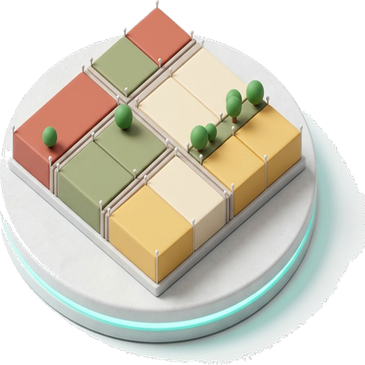

# ParcelFlux

**Parcel subdivision engine for QGIS — split zoning blocks with width variation, row asymmetry, fishbone offsets and residual merging.**

---

## Why ParcelFlux?

Hand-drawing parcels inside zoning blocks is slow, and naive equal-width splits look artificial. ParcelFlux subdivides blocks into parcels with *natural* variation — tunable width ranges, asymmetric rows, fishbone boundary offsets — while keeping every parcel inside the repaired real block footprint and cleaning up slivers automatically.

## ✨ Features

- **Single/double-row auto-detection** — narrow blocks get one parcel row; wider blocks split into two opposing rows.
- **Width variation** — per-parcel random width within a configurable range for natural-looking streetscapes.
- **Row width asymmetry** — different parcel widths on opposite sides of the centerline.
- **Fishbone offset** — organic zigzag at division-line endpoints that mimics traditional settlement morphology.
- **H-line shift** — asymmetric front/rear depths by moving the centerline away from the geometric midpoint.
- **3-pass residual merging** — slivers below an area threshold merge into the neighbor with the longest shared edge.
- **Actual-geometry subdivision** — irregular or invalid blocks are repaired and split inside the real footprint; the OBB is only a layout guide.
- **Computed facade metrics** — exterior frontage, side frontage, rear-edge proxy, corner flag and cardinal front direction.
- **Collision-safe schema** — generated fields fall back to `planx_*` names when the source layer already uses ParcelFlux names.

## 🚀 Installation

**From the QGIS Plugin Hub (recommended):** `Plugins → Manage and Install Plugins…` → search for **"ParcelFlux"** → *Install*.

**From a release zip:** download the latest zip from [Releases](https://github.com/YusufEminoglu/parcelflux/releases) → `Plugins → Install from ZIP`.

Requires QGIS 3.28 or newer (QGIS 4.x supported). No external Python dependencies; cancellation-safe background worker.

## 📖 Quick start

1. Load a zoning block polygon layer.
2. Open **ParcelFlux** from the menu or toolbar — the dock panel appears.
3. Select the block layer, set your target lot width (and any variation/asymmetry options), then click **RUN**.
4. The generated parcel layer is added to the map with facade metrics computed.

## ⚙️ Reference

The complete algorithm reference — every parameter with formulas and a step-by-step workflow — lives in **[docs/guide.html](docs/guide.html)**.

| Component | Where |
|-----------|-------|
| Dock panel UI & run logic | `dialogs/dock.py` |
| Standalone subdivision engine | `algorithms/parcel_flux_core.py` |
| Algorithm & parameter guide | `docs/guide.html` |

Full version history: [CHANGELOG.md](CHANGELOG.md)

## 🧩 Part of the PlanX ecosystem

This plugin is one of 15 open-source QGIS plugins for urban planning by the same author:

| Planning & analysis | CAD & production | 3D & visualization |
|---|---|---|
| [PlanX](https://github.com/YusufEminoglu/PlanX) — spatial-planning suite | [PlanX CAD Toolset](https://github.com/YusufEminoglu/PlanX-CAD) — drafting-grade CAD | [PlanX 3D City](https://github.com/YusufEminoglu/planx_3d_city) — Three.js city viewer |
| [GeoStats Lab](https://github.com/YusufEminoglu/planx_geostats) — spatial statistics | [EasyFillet](https://github.com/YusufEminoglu/EasyFillet) — tangent-arc fillet | [3D OSM Model](https://github.com/YusufEminoglu/osm_3d_model) — OSM → 3D city in browser |
| [Suitability Lab](https://github.com/YusufEminoglu/planx_suitability_lab) — raster MCDA | [Settlement Toolset](https://github.com/YusufEminoglu/PlanX-Settlement) — 9-stage settlement plans | [OSM Quick 3D](https://github.com/YusufEminoglu/osm_quick_3d) — OSM → native QGIS 3D |
| [DataCube Lab](https://github.com/YusufEminoglu/planx_datacube) — spatiotemporal cubes | [UIP Toolset](https://github.com/YusufEminoglu/PlanX-UIP) — Turkish master-plan automation | [Urban Procedural 3D](https://github.com/YusufEminoglu/planx_urban_procedural_3d) — parametric zoning lab |
| [Urban Resilience](https://github.com/YusufEminoglu/planx_urban_resilience) — 28 resilience tools | [ParcelFlux](https://github.com/YusufEminoglu/parcelflux) — parcel subdivision | [CartoLab](https://github.com/YusufEminoglu/planx_cartolab) — publication cartography |

## 📜 License & author

GPL-3.0-or-later © [Yusuf Eminoğlu](https://github.com/YusufEminoglu) — bug reports and feature requests welcome in [Issues](https://github.com/YusufEminoglu/parcelflux/issues).
